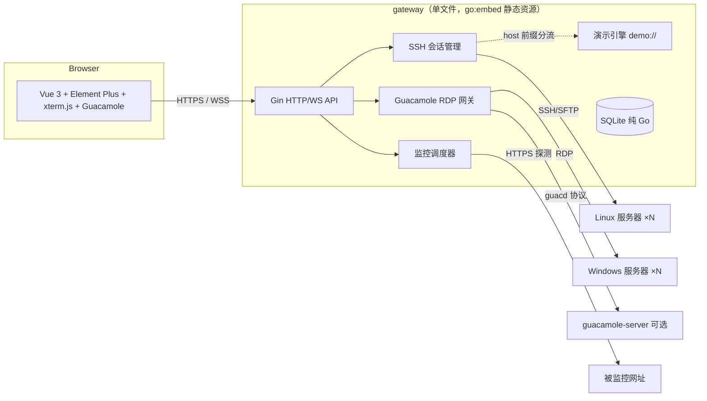

# WebServerMonitor（勤加软件 WEB 服务器运维管理平台 · 社区版）

> 零客户端 · 类 VPN 穿透 · Linux / Windows 服务器统一运维网关

面向中小企业与运维团队的**浏览器端服务器统一访问与运维平台**：无需在被管服务器上安装任何 Agent，通过浏览器即可完成 Web 终端、文件传输、远程桌面、网址可用性监控与多服务器集中管理，体验类 VPN 的统一入口。

本项目为**社区版**，以 Apache License 2.0 开源，无服务器数量与使用期限限制。企业版（高可用集群、审计合规增强、LDAP/SSO 等）与品牌 OEM 授权由[内蒙古勤加软件有限公司](#商业授权)提供。

## 核心特性

- **Web 终端**：基于 WebSocket + xterm.js 的交互式 SSH 终端，支持会话保持、窗口自适应、千条命令联想与中文自然语言运维输入（离线意图库 + AI 扩展）
- **SFTP 文件管理**：浏览器内完成远程文件浏览、上传、下载
- **远程桌面（Windows 服务器）**：一键生成 `.rdp` 调起本地 mstsc，或经内置 Guacamole 网关在浏览器中直接操作 Windows 桌面（H5，剪贴板双向同步、自适应缩放）
- **网址可访问性监控**：HTTPS 站点状态码 / 延迟 / TLS 证书有效期（含域名匹配与证书链校验）周期巡检，异常卡片置顶与分级告警
- **多服务器集中管理**：服务器分组、授权到人（用户-服务器级权限），操作日志留痕，Linux / Windows 混合管理
- **告警通知**：钉钉群机器人 / 企业应用机器人双通道
- **演示模式（Demo Engine）**：内置仿真引擎，无需任何真实 Linux 服务器即可完整体验与验收全部功能

## 技术创新点

1. **单文件零依赖交付**：前端静态资源经 `go:embed` 编译进二进制；SQLite 采用纯 Go 驱动（无 CGO），`CGO_ENABLED=0` 静态编译出**一个 exe 即完整平台**，目标机无需任何运行库
2. **仿真演示引擎**：虚拟文件系统 / 进程表 / 服务状态 + 命令白名单模拟器 + 监控场景合成器，`demo://` 前缀服务器在 SSH 层透明分流——开箱即用的"仿真环境"，降低试用、教学与验收成本
3. **零客户端架构**：所有能力经浏览器交付，被管服务器仅需标准 OpenSSH / RDP，无 Agent、无反向连接常驻进程
4. **终端智能输入**：Ghost 命令联想（1000+ 模板，覆盖国产数据库 / K8s / 信创 OS）+ 中文自然语言意图确认卡 + 澄清追问，全部离线可用
5. **跨平台一致性**：Windows（安装版 / 便携版）与 Linux（tar.gz + systemd）同一套代码与交互，按 exe 所在目录解析配置与数据，移动即迁移

## 架构



## 快速开始

### 从源码构建（推荐）

要求：Go ≥ 1.21、Node.js ≥ 18。

```bash
# 1. 构建前端（产物输出至 backend/static）
cd frontend && npm install && npm run build

# 2. 构建后端（社区版：-tags opensource 启用无限制社区授权）
cd ../backend
CGO_ENABLED=0 go build -tags opensource -o gateway.exe .        # Windows
CGO_ENABLED=0 GOOS=linux GOARCH=amd64 go build -tags opensource -o gateway .   # Linux x64
# 信创架构：GOARCH=arm64（鲲鹏/飞腾）、GOARCH=loong64（龙芯）
```

> 不带 `-tags opensource` 编译得到的是商业版构建（启用授权校验体系），社区用户请始终携带该 tag。

```bash
# 3. 运行
./gateway.exe          # 浏览器访问 http://localhost:8080/
# 默认管理员：admin / admin123（首次启动自动创建，请立即修改）
```

### 演示模式

无需任何真实服务器：添加服务器时主机填写 `demo:` 前缀（如 `demo:web01`），或使用内置演示账号体验仿真引擎（6 台模拟服务器、6 种监控场景、危险命令拦截）。

### H5 远程桌面（可选）

Windows 服务器的 H5 远程桌面需要 [guacamole-server](https://guacamole.apache.org/)（guacd）：

```bash
docker run --name guacd -d -p 4822:4822 guacamole/guacd
```

网关 `config.yaml` 中 `guacd_addr` 默认 `127.0.0.1:4822`，置为 `-` 可禁用 H5 入口（本地 `.rdp` 方式不依赖 guacd）。

## 目录结构

```
├── backend/                Go 服务端（Gin + GORM + 纯 Go SQLite）
│   ├── handler/            HTTP/WS 接口层（终端/SFTP/监控/RDP/授权...）
│   ├── ssh/                SSH/SFTP 会话管理（含演示会话分流）
│   ├── demo/               演示引擎（数据注入 + 命令模拟器）
│   ├── monitor/            网址监控（状态码/延迟/证书链校验）
│   ├── license/            授权模块（社区版经 -tags opensource 直通）
│   ├── tools/fingerprint/  主机指纹工具源码（商业授权流程使用）
│   ├── installer.iss       Windows 安装包脚本（Inno Setup 6，社区版）
│   ├── portable/           便携版服务注册 / 管理脚本
│   └── static/             前端构建产物（go:embed，随仓库提供以便免 Node 编译）
├── frontend/               Vue 3 + Element Plus + xterm.js + guacamole-common-js
└── docs/                   使用文档
```

## 文档

- [使用文档](docs/使用文档.md)
- [版本规划](ROADMAP.md)
- [参与贡献](CONTRIBUTING.md)
- [第三方组件许可声明](THIRD-PARTY-NOTICES.md)

## 商业授权

社区版遵循 [Apache License 2.0](LICENSE) 自由使用。企业版（多节点高可用、审计合规增强、LDAP/SSO、批量运维编排）、品牌 OEM 定制与信创适配服务请联系：**内蒙古勤加软件有限公司**。

## 许可证

本项目基于 [Apache License 2.0](LICENSE) 开源。
